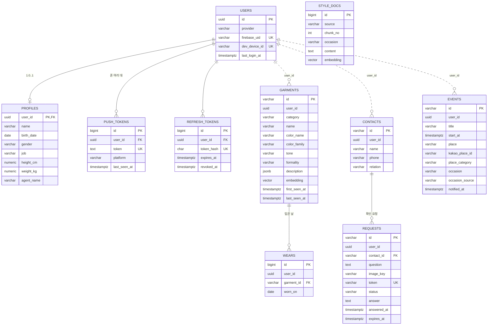

# 패션 에이전트 DB 설계 (PostgreSQL)

- DDL: [schema.sql](schema.sql) (PostgreSQL 16 + pgvector에서 실행 확인, 2026-11-04)
- 기준: 앱 레포 PR #12의 `docs/contracts/` (README 7절 "DB 나누기", openapi.yaml, mcp-tools.md)

## 큰 원칙

- **PostgreSQL 하나, 서비스마다 스키마 하나.** docker-compose의 `pgvector/pgvector:pg16` 한 대를 같이 씁니다.
- 다른 서비스 스키마는 직접 읽지 않습니다. 그래서 **스키마를 넘는 외래 키(FK)는 없습니다.** `user_id`는 `account.users.id`와 값만 같습니다(논리적 참조).
- 모든 테이블에 `user_id uuid`, `created_at`, `updated_at` (예외: 공용 지식인 `closet.style_docs`, 그리고 `account.users` 자체).
- 시간은 `timestamptz`, 서버 시간대 `Asia/Seoul`. `updated_at`은 각 서비스가 JPA `@PreUpdate`로 갱신합니다.
- 각 서비스는 `schema.sql`에서 자기 스키마 부분만 떼어 Flyway `V1__init.sql`로 씁니다.
- id: 사용자만 UUID, 도구가 주고받는 id는 약속 문서 예시대로 접두어 문자열(`e_`, `c_`, `h_`, `r_`), 내부 테이블은 숫자 자동 증가.

## ERD



## 스키마별 테이블

### account (gateway)

| 테이블 | 용도 | 핵심 |
| --- | --- | --- |
| `users` | 계정 | `provider` apple·google·dev. apple·google은 `firebase_uid`, dev는 `dev_device_id`가 꼭 있어야 함(CHECK) |
| `profiles` | 온보딩 회원정보 | 사용자당 1행, 전부 null 가능. 키 50~250cm, 몸무게 10~300kg CHECK |
| `push_tokens` | FCM 토큰 | 폰 여러 대 → 1:N. `token` UNIQUE라 같은 폰이 다른 계정으로 로그인하면 주인만 바뀜 |
| `refresh_tokens` | 리프레시 토큰 30일 | 원문 대신 SHA-256 해시. 로그아웃·재발급 때 `revoked_at` |

### schedule (mcp-schedule)

| 컬럼 | 설명 |
| --- | --- |
| `id` | `e_…` (도구의 eventId) |
| `title`, `start_at`, `place` | 사용자가 말한 일정 |
| `kakao_place_id`, `place_category` | 카카오 로컬로 찾은 장소와 분류 마지막 마디(예: 예식장). 못 찾으면 null |
| `occasion` | 자리 종류 6개: mourning·wedding·formal·business·active·casual |
| `occasion_source` | 분위기를 무엇으로 정했는지: `title`(제목 키워드)·`place`(장소 분류)·`default` |
| `notified_at` | 당일 아침 8시 알림 보낸 시각 |

인덱스: `(user_id, start_at)`은 `schedule_list`의 하루 조회용, `start_at WHERE notified_at IS NULL`은 8시 스케줄러용(실행 계획에서 이 인덱스를 타는 것 확인).

### closet (mcp-closet)

| 테이블 | 핵심 |
| --- | --- |
| `garments` | 검색·필터에 쓰는 값(category·color_family·tone·formality)은 컬럼으로, 나머지 Garment 전체는 `description jsonb`. `embedding vector(384)` + HNSW(코사인) 인덱스로 같은 옷 합치기와 `closet_search` |
| `wears` | 입은 날. `(garment_id, worn_on)` UNIQUE라 같은 날 두 번 기록 안 됨 |
| `style_docs` | 코디 지식 문서 조각(RAG). 모두 같이 쓰므로 user_id 없음 |

### helper (mcp-helper)

| 테이블 | 핵심 |
| --- | --- |
| `contacts` | 이름·전화번호·관계. 전화번호는 숫자만, 응답·로그에 내보내지 않음. `(user_id, phone)` UNIQUE |
| `requests` | 사진 R2 키, `/h/<token>` 링크 토큰, 상태 pending·answered·expired. answered면 답과 시각이 꼭 있어야 함(CHECK). pending만 훑는 만료 인덱스 |

## 아침 8시 일정 알림은 어떻게 도나

FCM 토큰은 `account.push_tokens`(gateway)에 있고, 약속상 mcp-schedule은 그 스키마를 못 읽습니다. 그래서 **토큰을 옮기지 않고 gateway에 "이 사용자에게 푸시 보내 줘" 내부 API를 하나 두는 방식**을 제안합니다.

```
mcp-schedule (매일 08:00 Asia/Seoul)
  1. SELECT … FROM schedule.events
       WHERE notified_at IS NULL AND start_at >= 오늘 0시 AND start_at < 내일 0시
  2. 사용자별로 묶어 gateway 내부 API 호출
       POST http://gateway:8080/internal/push  { userId, title, body }
         → gateway가 push_tokens로 FCM 전송 (만료된 토큰은 지움)
  3. 성공한 일정만 UPDATE schedule.events SET notified_at = now()
```

- 이렇게 하면 mcp-helper의 "가족 답장 왔어요" 알림도 같은 API를 씁니다. FCM 비밀 키도 gateway 한 곳에만 둡니다.
- `/internal/**`은 게이트웨이가 밖에서 오는 요청은 막습니다(Docker 내부망에서만).
- 아침 8시 이후에 등록한 오늘 일정은 알림을 보내지 않습니다(지금 설계 그대로).

## 팀이 정해야 할 것

1. **`/internal/push` 방식** 채택 여부: 약속 문서(README 7절, openapi)에 추가해야 합니다. 다른 방법은 mcp-schedule이 FCM을 직접 보내고 gateway에서 토큰을 받아 오는 것인데, 토큰이 두 곳에 퍼져서 추천하지 않습니다.
2. **분위기를 제목 우선으로 할지 장소 우선으로 할지**: 약속 문서는 장소 우선, 첫 구현은 제목 우선. DB는 `occasion_source`로 어느 쪽이든 기록만 하므로 결정과 상관없이 그대로 씁니다.
3. 회원 탈퇴 시 다른 스키마 데이터 삭제: FK가 없어 자동으로 안 지워집니다. gateway가 탈퇴 때 각 서비스에 삭제를 요청할지, 발표 범위에서는 빼도 될지.
4. 임베딩 차원 384는 약속 문서 초안 값입니다. mcp-closet이 고르는 임베딩 모델에 따라 바꿔야 할 수 있습니다.
