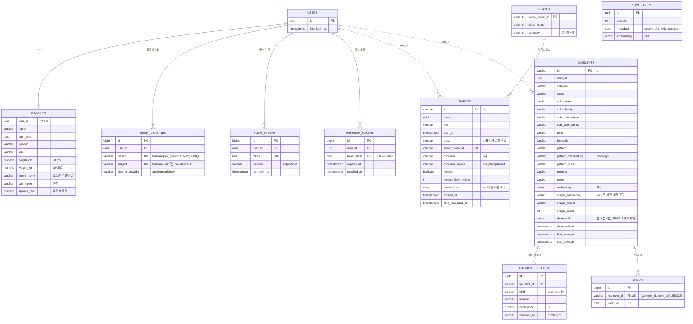

# Data Model: 데이터베이스 통합 설계

실행 SQL은 [docs/infra/db/](../../docs/infra/db/README.md)의 서비스별 `V*.sql`(각 레포 Flyway 마이그레이션 복사본)입니다. 이 문서와 SQL이 다르면 SQL이 맞고, 이 문서를 고칩니다.

2026-11-20 기준: 각 레포 `develop`의 V4(정규화)까지와 mcp-schedule V5(`remind_time`, mcp-schedule PR #12) 반영. account V4·schedule V4·closet V4는 젯슨 운영 DB(PostgreSQL 17 + pgvector)에도 적용됨.

## 한눈에

| 저장소 | 스키마·키 | 주인 | 표 |
| --- | --- | --- | --- |
| PostgreSQL | `account` | gateway | users, user_identities, profiles, push_tokens, refresh_tokens |
| PostgreSQL | `schedule` | mcp-schedule | places, events |
| PostgreSQL | `closet` | mcp-closet | garments, garment_defects, wears, style_docs |
| Redis | `agent:session:*` | agent | 대화 세션 (30분) |
| (메모리) | - | gateway | 사용량 제한(분당 횟수). 게이트웨이가 한 대라 Redis 안 씀 |
| (없음) | - | mcp-weather, mcp-clothes-state, mcp-face-check | 저장 안 함 |

`helper` 스키마(contacts, requests)는 mcp-helper를 보관(2026-11-12)하면서 쓰지 않습니다. 운영 DB에 스키마는 남아 있지만 이 설계에서는 뺐습니다.

## ERD

실선은 같은 스키마 안의 FK, 점선은 `user_id` 값만 같은 논리적 참조(FK 없음)입니다.



`style_docs`를 뺀 모든 표에 `created_at`이 있고, `garment_defects`도 뺀 표에 `updated_at`(timestamptz, 기본 now())이 있습니다. `closet.style_docs`는 Spring AI가 관리하는 표라 컬럼을 더하지 않습니다.

## 정규화 (2026-11-20 V4)

강사님 피드백("정규화 맞춰서")으로 세 레포에 V4 마이그레이션을 넣었습니다. 지금 표는 모두 BCNF이고, 다치 종속·조인 종속이 따로 없어 4NF·5NF도 만족합니다.

| 무엇 | 전 | 지금 | 이유 |
| --- | --- | --- | --- |
| 로그인 수단 | `users.provider`·`firebase_uid`·`dev_device_id`(provider에 따라 한쪽만 참) | `user_identities(issuer, subject)` 한 줄씩, `(issuer, subject)` 복합 UNIQUE | 칸이 다른 칸(provider)에 기대는 구조를 없앰. 한 계정에 수단 여러 개 |
| 장소 | `events.place_category` | `places(kakao_place_id PK, place_name, category)` + `events.kakao_place_id` FK | 분류는 장소 id가 정하는 값(이행 종속, 3NF) |
| 옷 설명 | `garments.description jsonb` | 무늬·소재·메모·보조색은 `garments` 칸, 얼룩·찢어짐은 `garment_defects` 한 줄씩 | 한 칸에 값 하나(1NF). 사진 속 위치·확신도처럼 그 사진에만 맞는 값은 저장 안 함 |
| 입은 날 | `wears.user_id` + `(garment_id, user_id)` 복합 FK | `wears.garment_id` FK만, `(garment_id, worn_on)` 복합 UNIQUE | 옷이 주인을 정하므로 user_id는 중복(3NF). `garments (id, user_id)` UNIQUE도 뺌 |
| 코디 지식 | `style_docs.metadata json` | 그대로 | Spring AI PgVectorStore가 정한 표 모양이라 바꾸면 라이브러리가 못 읽음 |

## 1. account (gateway)

| 표 | 컬럼 | 규칙 |
| --- | --- | --- |
| users | `id uuid` PK 기본 `gen_random_uuid()` | JWT `sub`, 모든 서비스의 `user_id`. 계정 자체만 둠 |
| user_identities | `user_id` FK(users, CASCADE) | 한 계정에 여러 줄 가능 |
| | `issuer` | firebase(Apple·구글) · dev |
| | `subject` | firebase uid, 또는 `POST /api/v1/auth/dev`의 deviceId. `(issuer, subject)` UNIQUE |
| | `sign_in_provider` | apple·google·dev. 마지막으로 쓴 방법, JWT `provider` 클레임 |
| profiles | `user_id` PK·FK(users, CASCADE) | 사용자당 1행 |
| | name, birth_date, gender, job, height_cm, weight_kg, agent_name, call_name, speech_rate | 전부 null 가능. 키 50~250, 몸무게 10~300, 생일 1900년 이후, 에이전트 이름 공백 금지 |
| push_tokens | `token` UNIQUE, `user_id` FK | 같은 폰이 다른 계정으로 오면 `ON CONFLICT (token) DO UPDATE SET user_id`. 지금 앱이 토큰을 보내지 않아 비어 있음 |
| refresh_tokens | `token_hash char(64)` UNIQUE | 원문 저장 안 함. 갱신 때 새 행 + 옛 행 `revoked_at` |

로그인은 `UPDATE user_identities … WHERE issuer = :i AND subject = :s RETURNING user_id`로 찾고, 없으면 `users`와 `user_identities`를 함께 넣습니다(gateway `AccountStore.login`).

## 2. schedule (mcp-schedule)

| 표 | 컬럼 | 규칙 |
| --- | --- | --- |
| places | `kakao_place_id` PK | 카카오 로컬 검색 결과 id |
| | `place_name` NOT NULL, `category` | 카카오에 등록된 이름, 분류의 마지막 마디(예: 예식장). 일정을 넣을 때 upsert |
| events | `id` | `e_` + 임의 문자열 (도구의 eventId) |
| | `title` | 공백 금지 |
| | `place`, `kakao_place_id` FK(places) | 말한 장소 그대로, 카카오에서 찾았으면 그 id(못 찾으면 null) |
| | `occasion` | mourning·wedding·formal·business·active·casual, 기본 casual |
| | `occasion_source` | title·place·default. 정하는 순서는 제목 → 장소 → 기본값 |
| | `remind`, `remind_days_before` | 폰 알림을 받을지, 며칠 전에 미리 알릴지. null이면 전날 저녁 + 당일 아침 |
| | `remind_time` | 미리 알림을 띄울 시각(V5, `time`). null이면 아침 8시, `remind_days_before`가 0이면 당일 알림 시각. `remind`가 false면 null |
| | `notified_at`, `care_reminded_at` | 서버가 기록만 하는 시각(일정 알림은 앱이 폰 로컬 알림으로 띄움) |

인덱스: `(user_id, start_at)`은 하루 조회, `(start_at)`은 아침 알림. 테스트를 H2로도 돌려서 부분 인덱스 대신 일반 인덱스입니다.

## 3. closet (mcp-closet)

| 표 | 규칙 |
| --- | --- |
| garments | 검색·필터에 쓰는 값(category·color_family·tone·formality)과 무늬(`pattern`, 판단 `pattern_checked_by` model·gpt, 모델 추측 `pattern_guess`)·소재·메모(500자)·보조색을 칸으로 둠. `embedding public.vector(384)`은 null 허용. 벡터 근사 인덱스 없음(research R3). V2: `image_embedding public.vector(768)`·`image_model`·`image_count` — 옷 사진 벡터(본 사진 평균, 최대 10장)와 만든 모델, 같은 옷 판단에 씀. V3: `thumbnail bytea`(옷 부분만 자른 긴 변 256px JPEG, 얼굴 없음, 64KB 제약)·`thumbnail_at` — 애매한 같은 옷을 GPT가 사진으로 비교할 때만 씀. 원본 사진은 저장하지 않음 |
| garment_defects | 옷마다 얼룩·찢어짐 여러 줄. `garment_id` FK(CASCADE), `kind`, `location`, `confidence numeric(4,3)` 0~1, `checked_by` model·gpt. 같은 옷을 다시 보면 그 옷의 줄을 지우고 새로 넣음 |
| wears | `garment_id` FK(garments, CASCADE). `(garment_id, worn_on)` UNIQUE(`wears_garment_day_uq`). 넣을 때 `ON CONFLICT ON CONSTRAINT wears_garment_day_uq DO NOTHING`. 주인은 `garments.user_id`로 조인해서 앎 |
| style_docs | Spring AI PgVectorStore 표 모양(`id uuid, content text, metadata json, embedding vector(384)`) + HNSW 코사인 인덱스. `source`·`chunkNo`·`occasion`은 metadata에. `(source, chunkNo)` 유니크 식 인덱스로 같은 조각 두 번 넣기 방지 |

자주 쓰는 쿼리(모두 `checks.sql`에서 확인):

```sql
-- 같은 옷 찾기 (closet_save, 사진 벡터가 있을 때): 같은 종류·같은 모델 벡터를 가져와 서버가 비교
SELECT id, image_embedding::text, image_count FROM closet.garments
 WHERE user_id = :userId AND category = :category AND image_model = :model AND image_embedding IS NOT NULL;

-- 같은 옷 찾기 (closet_save, 사진 벡터가 없을 때): 1 - 거리 >= 기준값이면 합침, 헷갈리면 새 옷
SELECT id, 1 - (embedding <=> :q) AS similarity FROM closet.garments
 WHERE user_id = :userId AND category = :category AND color_family = :colorFamily AND embedding IS NOT NULL
 ORDER BY embedding <=> :q LIMIT 1;

-- 옷장 후보 (closet_search)
SELECT g.*, (SELECT max(worn_on) FROM closet.wears w WHERE w.garment_id = g.id) AS last_worn_on
  FROM closet.garments g
 WHERE g.user_id = :userId AND g.embedding IS NOT NULL AND g.id <> ALL(:excludeIds)
 ORDER BY g.embedding <=> :q LIMIT :limit;

-- 한 사람의 입은 날 (wears에 user_id가 없어 옷과 조인)
SELECT w.garment_id, w.worn_on FROM closet.wears w JOIN closet.garments g ON g.id = w.garment_id
 WHERE g.user_id = :userId ORDER BY w.worn_on DESC;
```

## 4. Redis

[contracts/redis-keys.md](contracts/redis-keys.md)에 키 이름, 값, TTL을 적었습니다. 지금 Redis는 agent 대화 세션만 씁니다.

## 바뀐 점 (PR #14 초안 대비)

2026-11-04 V1 때 기록입니다. 그 뒤 V4 정규화에서 바뀐 것은 위 "정규화" 표에 있습니다(`wears` FK, 설명 JSON, helper 표는 지금과 다름).

| 무엇 | 전 | 지금 | 이유 |
| --- | --- | --- | --- |
| `closet.garments` 벡터 인덱스 | HNSW | 없음, `(user_id, …)` 인덱스 | research R3: 근사 인덱스 뒤에 user_id로 거르면 내 옷이 빠질 수 있음 |
| `closet.style_docs` 모양 | id bigint, source, chunk_no, occasion, content | id uuid, content, metadata json, embedding | research R4: Spring AI PgVectorStore가 그대로 읽고 쓰게 |
| `schedule.events` 8시 인덱스 | 부분 인덱스 | 일반 `(start_at)` | 실제 mcp-schedule 마이그레이션과 맞춤(H2 테스트) |
| 실행 파일 | `schema.sql` 하나 | 서비스별 `V1__init.sql` + 이어 붙인 `schema.sql` | 각 레포의 Flyway에 그대로 복사 |
| 제약 추가 | - | 생일 1900년 이후, 에이전트 이름 공백 금지, 설명은 JSON 객체, 마지막 본 시각 ≥ 처음, 전화번호 숫자만, 연락처 이름 공백 금지 | 잘못된 값이 말로 들어오는 경우를 DB에서 한 번 더 막음 |
| `profiles.gender` | varchar(10) | varchar(20) | 말로 받은 그대로 저장 |
| `closet.wears` FK | garment_id만 | (garment_id, user_id) | 입은 날의 주인과 옷의 주인이 다를 수 없게 |
| 스키마 이름 | `account.users`처럼 붙여 씀 | 파일 안에서는 안 붙임 | Flyway `default-schema`로 실행 |
