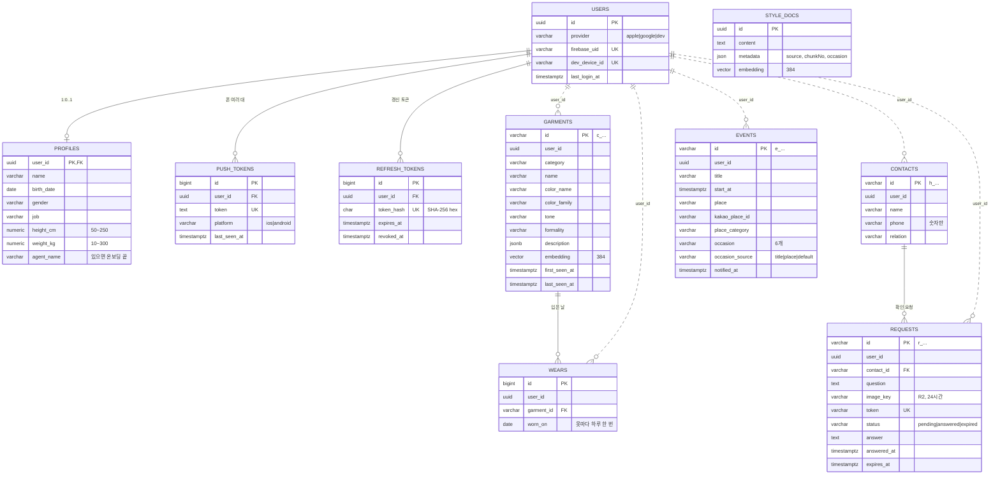

# Data Model: 데이터베이스 통합 설계

실행 SQL은 [docs/infra/db/](../../docs/infra/db/README.md)의 서비스별 `V1__init.sql`입니다. 이 문서와 SQL이 다르면 SQL이 맞고, 이 문서를 고칩니다.

## 한눈에

| 저장소 | 스키마·키 | 주인 | 표 |
| --- | --- | --- | --- |
| PostgreSQL | `account` | gateway | users, profiles, push_tokens, refresh_tokens |
| PostgreSQL | `schedule` | mcp-schedule | events |
| PostgreSQL | `closet` | mcp-closet | garments, wears, style_docs |
| PostgreSQL | `helper` | mcp-helper | contacts, requests |
| Redis | `agent:session:*` | agent | 대화 세션 (30분) |
| Redis | `request_rate_limiter.*` | gateway | 사용량 제한 |
| (없음) | - | mcp-weather, mcp-clothes-state, mcp-face-check | 저장 안 함 |

## ERD

실선은 같은 스키마 안의 FK, 점선은 `user_id` 값만 같은 논리적 참조(FK 없음)입니다.



모든 표에 `created_at`, `updated_at`(timestamptz, 기본 now())이 있습니다(`closet.style_docs` 제외: Spring AI가 관리하는 표라 컬럼을 더하지 않음). `updated_at`은 각 서비스가 JPA `@PreUpdate`로 바꿉니다(트리거 없음).

## 1. account (gateway)

| 표 | 컬럼 | 규칙 |
| --- | --- | --- |
| users | `id uuid` PK 기본 `gen_random_uuid()` | JWT `sub`, 모든 서비스의 `user_id` |
| | `provider` | apple·google·dev. 처음 가입한 방법 |
| | `firebase_uid` UNIQUE | apple·google이면 필수. 계정 연결해도 같은 값 |
| | `dev_device_id` UNIQUE | dev면 필수 |
| profiles | `user_id` PK·FK(users, CASCADE) | 사용자당 1행 |
| | name, birth_date, gender, job, height_cm, weight_kg, agent_name | 전부 null 가능. 키 50~250, 몸무게 10~300, 생일 1900년 이후, 에이전트 이름 공백 금지 |
| push_tokens | `token` UNIQUE, `user_id` FK | 같은 폰이 다른 계정으로 오면 `ON CONFLICT (token) DO UPDATE SET user_id` |
| refresh_tokens | `token_hash char(64)` UNIQUE | 원문 저장 안 함. 갱신 때 새 행 + 옛 행 `revoked_at` |

## 2. schedule (mcp-schedule)

mcp-schedule#3에 이미 들어간 `V1__init.sql`과 같습니다(복사본).

| 컬럼 | 규칙 |
| --- | --- |
| `id` | `e_` + 임의 문자열 (도구의 eventId) |
| `title` | 공백 금지 |
| `occasion` | mourning·wedding·formal·business·active·casual, 기본 casual |
| `occasion_source` | title·place·default. 정하는 순서는 제목 → 장소 → 기본값 |
| `notified_at` | 8시 알림 보낸 시각 |

인덱스: `(user_id, start_at)`은 하루 조회, `(start_at)`은 8시 알림. 테스트를 H2로도 돌려서 부분 인덱스 대신 일반 인덱스입니다.

## 3. closet (mcp-closet)

| 표 | 규칙 |
| --- | --- |
| garments | 검색·필터에 쓰는 값(category·color_family·tone·formality)은 컬럼, 나머지 Garment 전체는 `description jsonb`(객체만). `embedding public.vector(384)`은 null 허용(모델 준비 전). 벡터 근사 인덱스 없음(research R3) |
| wears | `(garment_id, worn_on)` UNIQUE. 넣을 때 `ON CONFLICT ON CONSTRAINT wears_garment_day_uq DO NOTHING`. FK는 `(garment_id, user_id) → garments(id, user_id)`라 남의 옷에 입은 날을 붙일 수 없음 |
| style_docs | Spring AI PgVectorStore 표 모양(`id uuid, content text, metadata json, embedding vector(384)`) + HNSW 코사인 인덱스. `source`·`chunkNo`·`occasion`은 metadata에. `(source, chunkNo)` 유니크 식 인덱스로 같은 조각 두 번 넣기 방지(다시 넣을 때는 id를 source+chunkNo로 만든 UUID로) |

자주 쓰는 쿼리(모두 `checks.sql`에서 확인):

```sql
-- 같은 옷 찾기 (closet_save): 1 - 거리 >= 기준값이면 합침, 헷갈리면 새 옷
SELECT id, 1 - (embedding <=> :q) AS similarity FROM closet.garments
 WHERE user_id = :userId AND category = :category AND color_family = :colorFamily AND embedding IS NOT NULL
 ORDER BY embedding <=> :q LIMIT 1;

-- 옷장 후보 (closet_search)
SELECT g.*, (SELECT max(worn_on) FROM closet.wears w WHERE w.garment_id = g.id) AS last_worn_on
  FROM closet.garments g
 WHERE g.user_id = :userId AND g.embedding IS NOT NULL AND g.id <> ALL(:excludeIds)
 ORDER BY g.embedding <=> :q LIMIT :limit;
```

## 4. helper (mcp-helper)

| 표 | 규칙 |
| --- | --- |
| contacts | `(user_id, phone)` UNIQUE, 번호는 숫자 9~15자리. 응답·로그에 내보내지 않음 |
| requests | `token` UNIQUE, 상태 3개, answered면 답·시각 필수. 첫 답만: `UPDATE … WHERE token = :t AND status = 'pending'`. 만료: `status='expired', image_key=NULL`. pending만 훑는 부분 인덱스 |

## 5. Redis

[contracts/redis-keys.md](contracts/redis-keys.md)에 키 이름, 값, TTL을 적었습니다.

## 바뀐 점 (PR #14 초안 대비)

| 무엇 | 전 | 지금 | 이유 |
| --- | --- | --- | --- |
| `closet.garments` 벡터 인덱스 | HNSW | 없음, `(user_id, …)` 인덱스 | research R3: 근사 인덱스 뒤에 user_id로 거르면 내 옷이 빠질 수 있음 |
| `closet.style_docs` 모양 | id bigint, source, chunk_no, occasion, content | id uuid, content, metadata json, embedding | research R4: Spring AI PgVectorStore가 그대로 읽고 쓰게 |
| `schedule.events` 8시 인덱스 | 부분 인덱스 | 일반 `(start_at)` | 실제 mcp-schedule 마이그레이션과 맞춤(H2 테스트) |
| 실행 파일 | `schema.sql` 하나 | 서비스별 `V1__init.sql` + 이어 붙인 `schema.sql` | 각 레포의 Flyway에 그대로 복사 |
| 제약 추가 | - | 생일 1900년 이후, 에이전트 이름 공백 금지, 설명은 JSON 객체, 마지막 본 시각 ≥ 처음, 전화번호 숫자만, 연락처 이름 공백 금지 | 잘못된 값이 말로 들어오는 경우를 DB에서 한 번 더 막음 |
| `profiles.gender` | varchar(10) | varchar(20) | 말로 받은 그대로 저장 |
| `closet.wears` FK | garment_id만 | (garment_id, user_id) | 입은 날의 주인과 옷의 주인이 다를 수 없게 |
| 스키마 이름 | `account.users`처럼 붙여 씀 | 파일 안에서는 안 붙임 | Flyway `default-schema`로 실행 |
